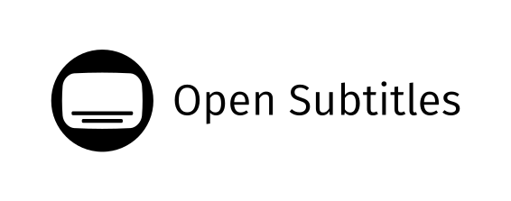

# Sportio Core

> The shared engine behind [Sportio](https://github.com/trenntl/SportioTV).
> Data · sync · parsers · EPG · playback — everything that isn't a screen.

<p align="center">
  
  
  
  
  
  <a href="https://hosted.weblate.org/engage/owntv/">
    
  </a>
</p>

<p align="center">
  <a href="https://github.com/trenntl/SportioTV_Core/actions/workflows/build.yml">
    
  </a>
  <a href="https://github.com/trenntl/SportioTV_Core/actions/workflows/i18n.yml">
    
  </a>
  <a href="https://github.com/trenntl/SportioTV_Core/actions/workflows/publish.yml">
    
  </a>
</p>

---

Sportio Core is the **headless half** of [Sportio](https://github.com/trenntl/SportioTV), the
open-source live-TV-and-sports **player** for Android TV. Everything that is not a screen lives
here: the Room database and every migration, playlist sync and parsing for **M3U / Xtream /
Stalker**, EPG, backup and restore, profiles, downloads, settings storage, **every user-visible
string**, and the **dual playback engine** — libmpv (FFmpeg) plus Media3/ExoPlayer.

Neither module renders anything. They use the Compose **runtime** for state, but no `compose-ui`,
no `compose-foundation`, no `androidx.tv.*` and no navigation.

> ⚠️ Sportio provides **no** channels, playlists, subscriptions, streams or media content. This is
> library code for building a player; the sources are the user's own.

Forked from [ahXN00/OwnTV_Core](https://github.com/ahXN00/OwnTV_Core) — thanks for the shoulders.
Technical identifiers stay `tv.own.owntv` (Maven group, packages, database) so artifacts remain
drop-in compatible; only the publisher changed.

---

## 🧩 The two modules

Published together, always on one version — two artifacts that must be used as a pair should not
have numbers that can disagree.

| Module | Namespace | What it is |
|---|---|---|
| **`:core`** | `tv.own.owntv.core` | Room database and migrations, sync, parsers, EPG, backup, profiles, downloads, settings, metadata, and every string. |
| **`:player-core`** | `tv.own.owntv.playercore` | The playback engine — libmpv plus the Media3/ExoPlayer handoff, the fallback ladder, watchdogs, live tuning and stream diagnostics. Depends on `:core`. |

## 📦 What's inside

### Playback (`:player-core`)
- **Dual engine** — libmpv (FFmpeg) for maximum codec compatibility, ExoPlayer (Media3) for
  near-instant Live TV, with an automatic fallback ladder between them
- **Every sound format on both engines** — ExoPlayer falls back to the FFmpeg that ships with the
  mpv engine for audio the device can't decode (DTS, TrueHD, MP2…), after the device's own
  decoders and passthrough
- **HLS, MPEG-DASH and raw MPEG-TS**, chosen from what the playlist declares, what the response
  actually is, and what the panel has already been caught doing — plus **Widevine / ClearKey** for
  channels that publish a licence server (ExoPlayer only; mpv has no CDM)
- **Watchdogs that assume the stream is hostile** — no-frame detection, stall recovery, surface
  resets, reconnect logic, and a live diagnostics log
- Zero-copy **4K HDR** direct rendering, frame-rate matching, throughput tracking, resolution and
  codec reporting, volume boost, subtitle shift and language selection
- Live timeline geometry for catch-up/rewind, hero and preview engines for browse screens

### Data & sync (`:core`)
- **Room** database with the full migration chain, plus paging
- Source parsing and sync for **M3U**, **Xtream Codes** and **Stalker/Ministra (MAC portal)** —
  incremental upserts, category fallbacks, and relinking of favourites, history and progress
- **EPG** (XMLTV) ingest, catch-up, and the guide's data model, plus title-or-description
  guide search (`EpgDao.searchGuide`) for sports channel matching
- Backup and restore, including encrypted password backup, and cross-device companion transfer
- Profiles, downloads, settings storage, metadata and trending, update checks

### Strings & translations (`:core`)
- Six Android resource components, packaged locales, and the toolkit that guards them:
  hardcoded-literal inventory, plural/CLDR validation, number-locale checks, overflow checks

## 🧱 Tech stack

Kotlin 2.4.20 · AGP 9.4.0 · Room 2.8.5 · SQLite 3.50 (bundled) · Media3 1.11.1 · libmpv ·
Koin 4.2.2 · OkHttp 5 · Coroutines 1.11.0 · WorkManager · DataStore · Paging 3 · KSP 2.3.11 ·
minSdk 26

## 📱 Who depends on this

- **[Sportio for Android TV](https://github.com/trenntl/SportioTV)** — televisions and set-top
  boxes, shipping. The only consumer.

**A change here affects the app.** Nothing is released from here until the TV app has been rebuilt
against it.

The app is updated automatically. Publishing a release here opens a pull request on it that moves
its `owntvCore` pin and refreshes its copy of `tools/i18n/locales.json`, and the app merges that
pull request itself once it has confirmed the two files agree with this repository. No app pins a
core version by hand.

## 🏗️ Building

Requires **JDK 21** and an Android SDK. Put the SDK path in `local.properties`:

```properties
sdk.dir=C:/Path/To/Android/Sdk
```

Then:

```bash
./gradlew :core:assembleRelease :player-core:assembleRelease   # build both AARs
./gradlew :core:testDebugUnitTest :player-core:testDebugUnitTest
./gradlew build                                                # everything, including lint
```

Instrumentation tests need a device or emulator, and are **never** run against a real TV that holds
real data — installing a test APK wipes the catalog, playlists, profiles and history.

```bash
./gradlew :core:assembleDebugAndroidTest        # compiles the test APK, installs nothing
```

## 📦 Consuming core from an app

Core publishes `tv.own.owntv:core` and `tv.own.owntv:player-core` to Sportio's own Maven repository —
public, **no account or token needed**. Upstream's repository additionally serves
`tv.own.owntv:libmpv`, the mpv engine built by
[OwnTV_libmpv](https://github.com/ahXN00/OwnTV_libmpv), which `player-core` depends on.

```kotlin
// settings.gradle.kts
maven {
    url = uri("https://trenntl.github.io/SportioTV_Core/maven")
    content { includeGroup("tv.own.owntv") }
}

// build.gradle.kts
implementation("tv.own.owntv:core:1.0.70")
implementation("tv.own.owntv:player-core:1.0.70")
```

The repository is this repo's `gh-pages` branch, written only by the publish workflows (the newest 30
core versions are kept).

### Local development against core's source

```properties
owntv.corePath=E:/Path/To/SportioTV_Core
```

The app's `settings.gradle.kts` picks that up and includes this repo as a **composite build**, so a
core edit shows up in the next app build with no publish step. Leave the property unset and the app
resolves the published artifact instead, which is what CI does.

### Hooks an app must supply

Core deliberately knows nothing about the app hosting it. Five hooks are assigned in the
application's `onCreate`, **before Koin starts** — `CrashRecorder` reads the version before the
container exists:

| Hook | Supplies |
|---|---|
| `CoreBuildInfo` | versionName, versionCode, edgeKey, devTools, debug, diagnosticBuild, releaseRepo |
| `CrashRecorder.diagnostics` | the live diagnostics log |
| `LiveSessionLimit.report` | per-provider stream quirks |
| `SubtitleFontAssets.resourceOf` | the app's bundled subtitle fonts |
| `AppIconSwitcher.mainActivityClass` | the app's `MainActivity` |

`onCreate` also **returns at once when `AppIconSwitcher.isRestartProcess(this)`** — the few
milliseconds core's `AppRestartActivity` runs in its own process to reopen the app after an icon
change, where nothing may start.

One more is supplied from the playback screen rather than `onCreate`, because it is a live signal
rather than a value:

| Hook | Supplies |
|---|---|
| `WatchSession` | which playlist is on screen — `open(sourceId)` / `close(sourceId)` |

`WatchSession` is what lets core's background work step out of the user's way.

An app also needs `android.nonTransitiveRClass=false` in its `gradle.properties` if it references
core's strings as a bare `R.string.*`.

## 🌍 Translations

<!-- i18n-contribution:start -->
## Help translate Sportio

Sportio inherits its strings from upstream OwnTV and is rebranded on top. Found a bad Sportio string in your language, or want to add a language? Head to [Hosted Weblate](https://hosted.weblate.org/projects/owntv/) — that is where the translations live, and this fork merges them down. If your language is not listed there, [open a language request ticket](https://github.com/trenntl/SportioTV/issues/new?template=feature_request.yml&title=%5BLanguage%5D%20Add%20) first. Once the language appears on Hosted Weblate, you can start translating it there. See the [language contributor guide](tools/i18n/README.md) for identifiers, validation, and promotion policy.
<!-- i18n-contribution:end -->

New user-visible text is never English-only: a string is not finished until it exists in every
packaged locale. All validators must pass before any string change lands:

```bash
python tools/i18n/validate_strings.py
python tools/i18n/check_hardcoded_strings.py verify --bootstrap
python tools/i18n/gen_supported_locales.py check
python tools/i18n/check_text_overflow.py
```

## 🔢 Versioning

Core versions are **independent of the TV app's releases** and must never be confused with them.
Tags are prefixed — `core-1.0.70` — and pushing one publishes both modules from CI. The
**Release core** workflow (Actions tab → Run workflow) pushes that tag for you: it reads `coreVersion`
from `main` and refuses if the tag already exists or `CHANGELOG.md` has no section for it.

Every published version also gets a [**GitHub Release**](https://github.com/trenntl/SportioTV_Core/releases),
and the order is deliberate: CI runs the full gate, publishes both artifacts to the Maven repository, waits
until they are served, and only then publishes the release. So a release exists only for a version that actually built and
shipped — and it is the release, not the tag, that opens the pull request moving the app onto the
new version. A tag whose tests fail stops there, with nothing downstream moved.

## 🤝 Contributing

Contributions, bug reports and ideas are welcome. Two things to know before opening a pull request:

- **Core never imports from an app.** The dependency arrow is one-way: app → `:player-core` →
  `:core`. If core needs something from the host, it takes a hook the app assigns.
- **Core stays UI-framework-neutral.** `compose-runtime` is the only Compose artifact allowed.

## 🙏 Credits


Core holds every string in the suite, translated on
[**Weblate**](https://weblate.org/), which hosts the project free of charge for libre software.
Thank you to Weblate and to every translator. (Strings live upstream — translation happens on the
OwnTV project and merges down.)


Metadata and trailers are provided by [TMDB](https://www.themoviedb.org/).
**This product uses the TMDB API but is not endorsed or certified by TMDB.**



Subtitle search and downloads are powered by [OpenSubtitles](https://www.opensubtitles.com/).

Forked from **[ahXN00/OwnTV_Core](https://github.com/ahXN00/OwnTV_Core)** — database, sync,
parsers, player engines and the i18n toolkit come from there.

### ▶️ Playback engines

[libmpv / mpv](https://mpv.io/) (FFmpeg), built for OwnTV by [OwnTV_libmpv](https://github.com/ahXN00/OwnTV_libmpv) from
[jarnedemeulemeester/libmpv-android](https://github.com/jarnedemeulemeester/libmpv-android) · [Media3 / ExoPlayer](https://developer.android.com/media/media3)

## ⚖️ Legal

Sportio Core is media **player** infrastructure only. It ships with no channels, playlists,
subscriptions or content, and does not endorse or facilitate access to unauthorized streams. Users
of the apps built on it are solely responsible for the sources they add.

## 📄 License

Released under the **GNU General Public License v3.0 (GPLv3)** — see [LICENSE](LICENSE).

---

<sub>Sportio Core — the shared engine behind Sportio. Forked from OwnTV_Core.</sub>
